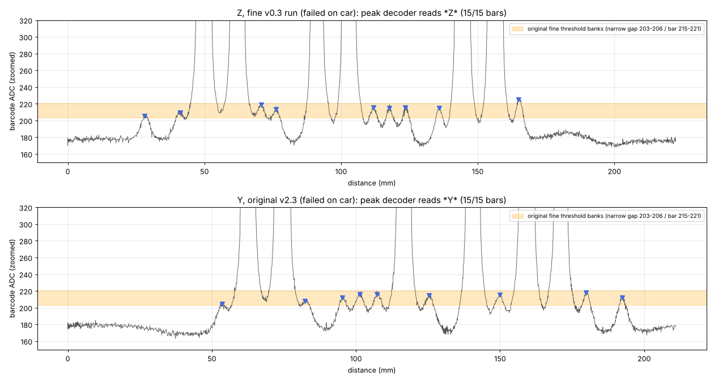

# Wi-Fi V2.3 + barcode peak decoder v0.1

The team's **original SDK Wi-Fi V2.3** (commit `8d7f3aa`) with one addition: a second barcode
decoder that reads bars from **peak positions** in the GP27 signal instead of a single ADC
threshold. Everything else is unchanged V2.3: driving, line following, junction turns,
calibration, MQTT and the original barcode decoder.

It does **not** include the Buddy4 add-on or ramp assist.

**Bench result (2026-10-30):** with the active build, the test barcodes that the original
decoder had stopped reading were all decoded on the car (user report).

## Why it was needed

The original decoder looks for one ADC threshold that separates every bar from every gap.
On the current car, the barcode IR (GP27) gives these levels:

| Feature | ADC |
|---|---|
| white | ~175 |
| narrow bar (3 mm) | 204–225, only a small bump |
| gap next to a narrow bar | 190–209 |
| wide bar (9 mm) | 1,700–2,300 |

Narrow bars and gaps overlap, so no threshold works. Earlier the margin was only ~10–15 ADC;
a sub-millimetre change in sensor height or tilt removed it. The **position** of every bar is
still clear in the signal, and that is what the peak decoder uses.



## How it works — [`barcode_peak.h`](barcode_peak.h)

1. **Smooth:** average GP27 over ~0.5 mm of travel.
2. **Find bars:** every local maximum rising ≥ 20 ADC above the white baseline with ≥ 4 ADC
   prominence is a bar. Peaks closer than 3 mm count as one bar.
3. **Group:** a label ends after 24 mm with no bar. With ≥ 15 bars, one early try is made
   after 12 mm, so the letter arrives ~11 mm after the label.
4. **Classify:**
   - **Bars:** wide or narrow by height relative to the tallest bar in the label.
   - **Spaces:** wide or narrow from bar-centre spacing, measured in the label's own narrow
     width, so wheel-distance errors cancel.
5. **Accept** only a complete Code39 `*X*` frame, read in either direction:
   - 15 bars, 6 of them wide;
   - narrow gaps between characters;
   - a valid middle character;
   - no unclear bar heights or space widths.

   A label with 1–2 extra noise bumps is retried without its weakest narrow bars; every retry
   must give the same letter.

The original 63-threshold decoder still runs alongside, unchanged.

## Two builds from the same source

| CMake option | Output | Behaviour |
|---|---|---|
| `-DBARCODE_PEAK_ACTIVE=OFF` (default) | `buddy123_interface_wifi_v2_3_barcode_peak_v0_1_shadow` | The peak decoder **only logs**; the car acts on the original decoder exactly as in V2.3. |
| `-DBARCODE_PEAK_ACTIVE=ON` | `buddy123_interface_wifi_v2_3_barcode_peak_v0_1_active` | If the peak decoder reads a label the original missed, the letter goes through the **normal path**. The dashboard shows it and the junction acts on it. |

**Active build safeguards:**

- If the original decoder already accepted that label, nothing changes.
- If the original decoder later reads a *different* letter for the same label, its existing
  conflict rule cancels the pending action.

## Build

You need the pinned Pico SDK `98a542c1a62fb549ffb5d66a3e5892b06276b670` (with submodules)
and `arm-none-eabi-gcc`; see [BUILD.md](BUILD.md).

1. Create `wifi_config.local.h` from `wifi_config.example.h` with your own network and broker.
   It is git-ignored; never commit it. The resulting UF2 contains those credentials, so keep
   UF2 files out of Git too.
2. Build:

```sh
export PICO_SDK_PATH=/path/to/pico-sdk
cmake -S . -B build-active -G Ninja -DCMAKE_BUILD_TYPE=Release -DPICO_BOARD=pico_w -DBARCODE_PEAK_ACTIVE=ON
cmake --build build-active
# shadow: same commands with -DBARCODE_PEAK_ACTIVE=OFF and another build folder
```

Flash with BOOTSEL and copy the `.uf2`. After the first boot, press `h` in the serial
terminal and check the `CAL FRONT` line. Calibration commands (`w`/`l`/`r`/`k`/`c`) are as in
V2.3, and they do **not** affect barcode reading.

## Seeing what it decodes

- **Dashboard (active build):** the decoded letter and the queued action appear in the usual
  place.
- **Serial (USB):** one line per label, for example:
  `BPEAK v0.1 active bars=15 code=Z reason=0 dir=rev removed=0 unit=2.95mm nspace<=1.17 wspace>=3.01 nrise>=38 base=175 orig=none APPLIED`
- **MQTT telemetry:** one **source-15** frame per label of ≥ 6 bars (`0xF2`, length 24,
  subtype `0xB1`). The dashboard shows it as undecoded; decode a native capture with:

```sh
python3 barcode_peak_decode.py <mosquitto_capture.txt> [FROM_LINE TO_LINE]
```

Useful columns:

- `decoded`, `code`, `reason`: why a label was rejected, e.g. `too_few_bars`, `space_unclear`.
- `bars`: bars in the label; 15 for a full `*X*` label.
- `min_narrow_rise`: the narrow-bar contrast.
- `applied`: whether the active build queued the letter.
- `orig_same_frame`: whether the original decoder read the same label.

## Tests

```sh
sh run_barcode_peak_tests.sh        # needs clang or gcc, python3, node
```

The suite covers:

- **The four real scans** that failed on the car (Z ×3, Y), streamed through the actual C
  code. Each decodes once. They still decode with ±10 % wheel-distance error, half the sample
  rate and ±15 ADC offset.
- **Synthetic labels:** every supported character, both directions, with an optical model
  matched to the real scans, plus noise, speed changes and stutter. 930/936 decoded,
  **0 wrong letters**.
- **Harsh conditions:** low contrast, high noise. Many are rejected, **0 wrong letters**.
  An offline run of 20,000 trials also gave 0.
- **Not-barcodes:** white, junction stripes, partial or damaged labels, random bar patterns,
  overflow, backwards odometry. None produce a decode.
- **The existing V2.3 suite** (`run_tests.py`, 35 C executables).

Results: [BARCODE_PEAK_HOST_TESTS_v0_1.txt](BARCODE_PEAK_HOST_TESTS_v0_1.txt).

## Files

| File | What |
|---|---|
| [`barcode_peak.h`](barcode_peak.h) | The decoder (pure C, no SDK; all constants at the top) |
| [`barcode_peak_harness.h`](barcode_peak_harness.h) | Glue into V2.3: sampling hook, active/shadow logic, telemetry, `BPEAK` line |
| `v12_2/baseline/testing/subsystem2/circuit_with_barcode/main.c` | The only V2.3 source change: 3 lines (include, reset at run start, call per GP27 sample) |
| [`CMakeLists.txt`](CMakeLists.txt) | `BARCODE_PEAK_ACTIVE` option and versioned output names |
| [`barcode_peak_tests/`](barcode_peak_tests) | Host tests and the four real captures |
| [`barcode_peak_decode.py`](barcode_peak_decode.py) | Source-15 decoder for MQTT captures |
| [`BARCODE_PEAK_V0_1.md`](BARCODE_PEAK_V0_1.md) | Design notes and evidence |
| [`BARCODE_PEAK_V0_1.patch`](BARCODE_PEAK_V0_1.patch) | Full diff against original V2.3 |
| [`BARCODE_PEAK_BUILD_MANIFEST_v0_1.json`](BARCODE_PEAK_BUILD_MANIFEST_v0_1.json) | Build record and UF2/ELF hashes (images kept locally, not in Git) |
| [`README_V2_3_ORIGINAL.md`](README_V2_3_ORIGINAL.md) | The original V2.3 README (calibration preset, architecture) |

## Limits and next steps

- Only full-size labels (narrow bars ~3 mm) are supported. The characters `$ / + %` are not
  supported, because they have no wide bars.
- A junction closer than ~12 mm behind a label's last bar would merge into the label;
  12 mm or more is fine.
- Not yet tested on the car: more letters, curves and ramps.
- **Next:** port the decoder into the Buddy4 / ramp-assist build
  (`testing/subsystem2/interface_wifi_v2_3`). Optionally add a source-15 card to the
  dashboard.
- **Optional hardware improvement:** a matte black tape shroud with a ~2 mm slit over the
  barcode IR would raise narrow-bar contrast and block room light. Test it as a separate
  change.
